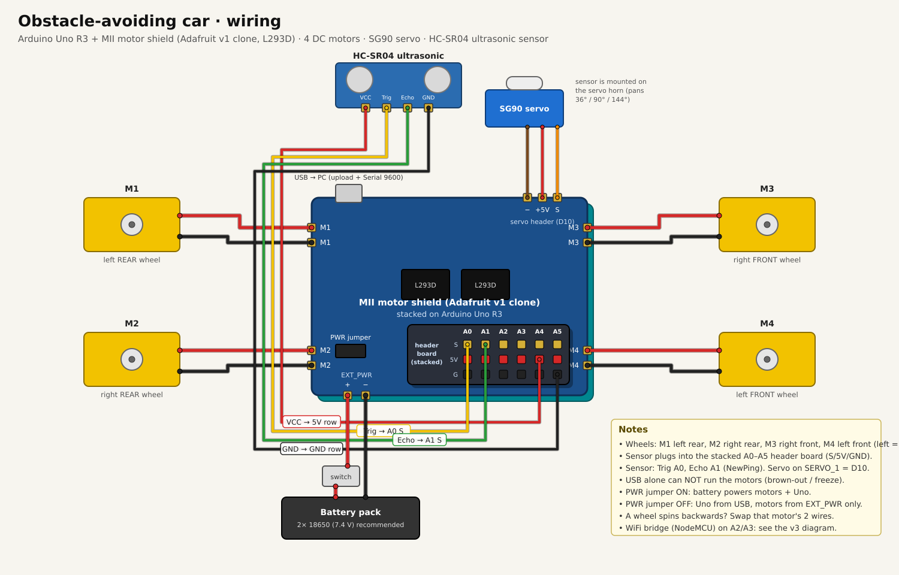
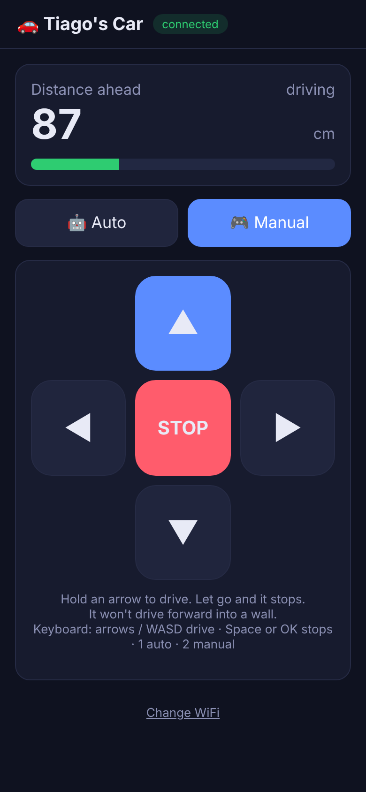
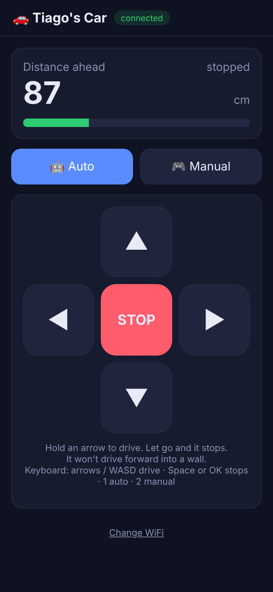
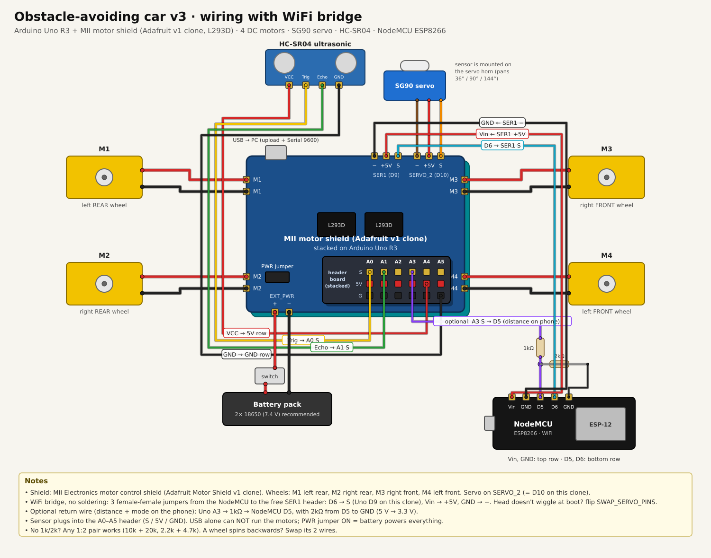

# 🚗 Arduino Obstacle-Avoiding Car

4-wheel robot car that drives on its own, scans with an ultrasonic sensor on a servo, and turns toward the most open direction. It can also be driven by hand over the serial port. Those same commands are what a future WiFi bridge will send.

## Hardware

| Part | Notes |
|---|---|
| Arduino Uno R3 (genuine, VID 2341 / PID 0043) | Board: **Arduino Uno** in the IDE (not Mega) |
| MII Electronics "motor control shield for Arduino" (Adafruit Motor Shield v1 clone, 2× L293D) | Stacked on the Uno. Has 2 servo headers (SERVO_1 = D10, SERVO_2 = D9) |
| 4× TT DC gear motors + wheels | M1 left rear, M2 right rear, M3 right front, M4 left front (left side = M1+M4, right side = M2+M3). Check yours with `motor_test/` |
| SG90 micro servo | Plugged into the header labeled SERVO_2, which is **pin D10** on this clone |
| HC-SR04 ultrasonic sensor | Mounted on the servo horn. Trig A0, Echo A1 |
| Small A0–A5 header board, stacked on the shield (S / 5V / GND rows, servo-style) | The sensor plugs in with female jumper wires, so there's no soldering. |
| NodeMCU ESP8266 (ESP-12E, CP2102 USB) | v3 WiFi bridge, on the free SER1 servo header. Windows needs the Silicon Labs CP210x driver to see its COM port. |
| Battery pack | 2× 18650 (7.4 V) recommended → `EXT_PWR`. **USB alone can't run the motors.** |

## Wiring

| From | To |
|---|---|
| Left **rear** wheel | M1 |
| Right **rear** wheel | M2 |
| Right **front** wheel | M3 |
| Left **front** wheel | M4 |
| Servo brown / red / orange | servo header − / +5V / S (D10) |
| HC-SR04 VCC | header **5V** row |
| HC-SR04 Trig | header **A0 S** |
| HC-SR04 Echo | header **A1 S** |
| HC-SR04 GND | header **GND** row |
| Battery + (through switch) / − | EXT_PWR + / − |

**PWR jumper on the shield:**
- **ON:** the battery powers the motors and the Uno.
- **OFF:** the Uno runs from USB and the motors run only from the battery. This is the safest setup for testing at the PC.

The diagram is generated from code: `cd docs/src && python3 gen_car.py ../wiring.svg && rsvg-convert -w 1500 ../wiring.svg -o ../wiring.png`

## Software

**Libraries** (Arduino IDE → Sketch → Include Library → Manage Libraries):
- `Adafruit Motor Shield library` (the **V1** one, AFMotor)
- `NewPing`
- `Servo` (built in)

**Upload:** open `obstacle_car_v2/obstacle_car_v2.ino`, select Tools → Board → **Arduino Uno**, pick the COM port, and click Upload.
A correct build reports about **5.8 KB of flash and 263 bytes of RAM**. If RAM shows about 120 bytes, you uploaded v1.

### Serial control (9600 baud)

| Key | Action |
|---|---|
| `a` | auto mode (drive + avoid obstacles) |
| `m` | manual mode (stops) |
| `f` / `b` | forward / back (manual) |
| `l` / `r` | short spin left / right (manual) |
| `s` | stop (switches to manual) |

Auto mode prints `DIST <cm>` twice a second and `SCAN L=.. R=..` on each avoidance. Manual mode refuses to drive forward into anything closer than 30 cm and prints `BLOCKED`.

`bool autoMode = true;` makes the car drive on its own 2 s after power-on. Set it to `false` for bench testing so it waits for commands.

### Tuning (top of the sketch)

| Constant | Default | What it does |
|---|---|---|
| `CRUISE_SPEED` / `SLOW_SPEED` | 150 / 100 | motor PWM (0–255) |
| `COLL_DIST` / `SLOW_DIST` | 30 / 60 cm | stop-and-scan / slow-down distance |
| `TURN_MS` / `TURNAROUND_MS` | 1500 / 1700 | spin time; lower it if the car over-turns |
| `BACKUP_MS` | 300 | how long it reverses before scanning |

## v3: WiFi phone remote (NodeMCU ESP8266) ✅ tested

| Driving (holding ▲) | Auto mode |
|---|---|
|  |  |

Two sketches:
- `obstacle_car_v3_wifi/` goes on the **Uno**. It's v2 plus a second serial link (commands in on the SER1 header, optional status out on A3) and a safety stop.
- `esp8266_bridge/` goes on the **NodeMCU**. It handles WiFi setup, the phone web page, and over-the-air updates.

### Extra wiring (no soldering)
The servo is plugged into the header labeled **SERVO_2**, and the NodeMCU uses the free **SER1** header next to it. On this clone the labels don't match the usual pins: **SERVO_2 = D10, SER1 = D9** (`SWAP_SERVO_PINS 1`).

| NodeMCU | SER1 header |
|---|---|
| **D6 / GPIO12** (bottom row) | **S** (Uno D9) |
| **Vin** (top row) | **+** (5 V) |
| **GND** (top row) | **−** |

**Check the servo pin:** on power-up the sensor head wiggles left and right, and the Serial Monitor (9600) prints `Servo on D10, WiFi bridge on D9`. If the head doesn't move, flip `SWAP_SERVO_PINS` and upload again.

**Optional return wire** (shows distance and mode on the phone): Uno **A3** → **1 kΩ** → NodeMCU **D5**, plus **2 kΩ** from D5 to GND. Without it, driving works and the page shows "connected · no feedback wire".

### Setting up the NodeMCU (once)
1. Arduino IDE → File → Preferences → Additional Boards Manager URLs: `http://arduino.esp8266.com/stable/package_esp8266com_index.json`
2. Tools → Board → Boards Manager → install **esp8266**. Then Library Manager → install **WiFiManager** (by tzapu).
3. Tools → Board → **NodeMCU 1.0 (ESP-12E Module)**. Plug in the NodeMCU's own USB (CP2102 chip) and upload `esp8266_bridge.ino`.
4. On your phone, join WiFi **TiagoCar-Setup**. A page opens: pick your home WiFi and enter the password.
5. Open **http://tiagocar.local**, or the IP address the Serial Monitor shows at 115200 baud.

### Using it
- **Hold** an arrow to drive. **Let go** and it stops. The page repeats the command every 150 ms, and the Uno stops if commands stop arriving for 600 ms (finger lifted, phone locked, WiFi dropped).
- It won't drive forward into anything closer than 30 cm.
- **Keyboard** (PC, TV, or a mini wireless keyboard): arrows/WASD drive, Space/Enter stop, `1` auto, `2` manual.
- **Change WiFi:** hold the NodeMCU's **FLASH** button for 3 s, or tap *Change WiFi* on the page. It reopens the setup hotspot.
- **Update the NodeMCU without USB:** Arduino IDE → Tools → Port → `tiagocar at …`. The password is `tiagocar` (set in the sketch).

### WiFi troubleshooting (what fixed it on our ASUS mesh: lower TX power)
- **Reboots while connecting** (`rl` / garbage in the Serial Monitor): power dips when the radio transmits. The sketch sets `WiFi.setOutputPower(10)`, which fixes it. On the car, the battery supplies 5 V through the shield.
- **"Connect to new AP Failed" / disconnect reason 2 (AUTH_EXPIRE):** on our ASUS mesh this went away once TX power was lowered, with **802.11ax mode** turned off on the router. If it ever comes back: create a **2.4 GHz-only guest/IoT network** in the ASUS app (WPA2-Personal, **Access Intranet ON**) and pick that one on the TiagoCar-Setup page.
- The ESP8266 only does **2.4 GHz** and **WPA2** (no WPA3-only networks).

### Bridge protocol
- Phone → NodeMCU → Uno: one character (`a m f b l r s`).
- Uno → NodeMCU every 300 ms: `S,<A|M>,<F|B|T|X>,<cm>`. The NodeMCU serves this to the page as JSON at `/status`.

## v1 → v2 changes

`v1_original/` keeps the first sketch unchanged. v2 fixes:
1. **Stutter:** v1 brought the speed up from 0 on every loop pass, so the car kept slowing down and speeding up. v2 only does that when starting from a stop.
2. **False stops:** a no-echo reading (0 cm) counted as "wall". v2 treats it as open road and takes the median of 3 pings.
3. **Blind driving:** v1 went about 600 ms between sensor readings. v2 reads continuously.
4. **Never reversed:** v2 backs up before scanning, slows down near objects, and turns around when boxed in.
5. **Serial control** added, ready for a WiFi bridge.

## Troubleshooting

| Symptom | Cause / fix |
|---|---|
| Serial prints one line, then freezes or resets | Motors running on USB power → brown-out. Connect the battery, or use manual mode at the PC. |
| Upload fails | Board set to Mega. Choose **Arduino Uno**. |
| One wheel spins backwards | Swap that motor's 2 wires on its M terminal. |
| Car won't turn, front and rear wheels fight | Motor terminals aren't left/right pairs. Run `motor_test/` and fix the 4 `AF_DCMotor` lines (this car: left = M1+M4, right = M2+M3). |
| Servo doesn't move / phone commands ignored | Servo and bridge pins swapped. Flip `SWAP_SERVO_PINS`. |
| Car over- or under-turns | Adjust `TURN_MS`. |
| Stops for no reason | Sensor angled down at the floor, or loose Trig/Echo wires. |

## Roadmap (done in v3)

An ESP32 (about $10) acts as a WiFi bridge:
- It hosts a phone web page: drive pad, auto/manual toggle, live distance readout.
- It uses WiFiManager: if the home WiFi changes, join the car's own setup hotspot from a phone and pick the new network. No reflashing.
- It sends the same one-letter commands to the Uno over SoftwareSerial through the free SER1 servo header.
- The Uno TX → ESP32 RX line needs a 5 V → 3.3 V divider.
